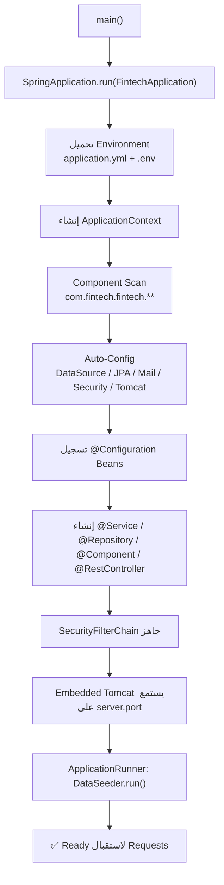
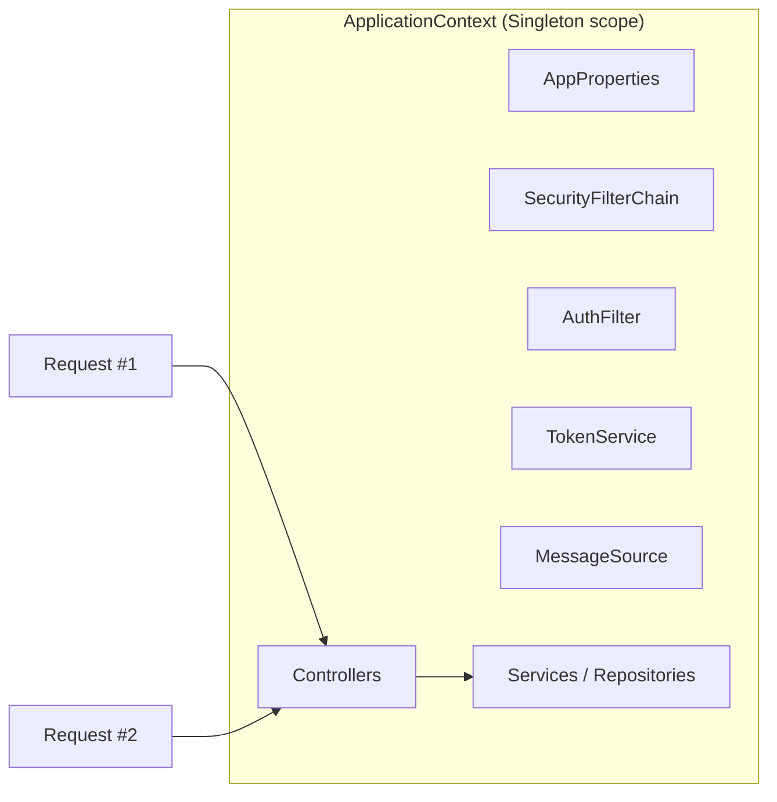
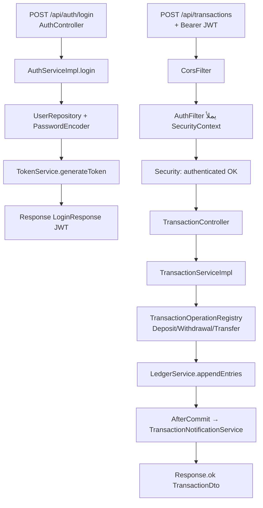

# Application Lifecycle — FinTech Spring Boot

دليل تعليمي يشرح **مرحلتين** في مشروعنا الفعلي (`com.fintech.fintech`):

1. **Startup** — من `main` حتى التطبيق جاهز يستقبل طلبات  
2. **Request** — من Postman حتى الـ Controller (والـ Exception handlers)

كل الأسماء هنا مأخوذة من كود المشروع الحالي.

---

## خريطة سريعة للحزم

```
com.fintech.fintech
├── FintechApplication.java          ← نقطة الدخول
├── config/                          ← AppConfig, I18nConfig, DataSeeder
├── common/config/AppProperties      ← إعدادات app.* من YAML
├── common/i18n/Messages
├── security/                        ← SecurityFilter, AuthFilter, JWT, CORS
├── exception/                       ← GlobalExceptionHandler + 401/403 handlers
├── auth|account|transaction|…       ← Controllers / Services / Repositories
└── response/Response                ← غلاف الـ API الموحّد
```

---

# 1️⃣ مرحلة الـ Startup (Run / Boot)

## 1.1 نقطة البداية

```18:20:src/main/java/com/fintech/fintech/FintechApplication.java
	public static void main(String[] args) {
		SpringApplication.run(FintechApplication.class, args);
	}
```

الكلاس معلّم بـ:

| Annotation | المعنى في مشروعنا |
|------------|-------------------|
| `@SpringBootApplication` | Component scan + Auto-configuration + Configuration |
| `@EnableAsync` | تفعيل `@Async` (مثل `NotificationServiceImpl.sendEmail`) |
| `@EnableScheduling` | تفعيل `@Scheduled` في `TokenBlacklistService` |
| `@EnableConfigurationProperties(AppProperties.class)` | ربط `app.*` من `application.yml` → `AppProperties` |



---

## 1.2 ترتيب ما يحدث داخل الـ ApplicationContext

### أ) قراءة الإعدادات (Environment)

من `src/main/resources/application.yml` (وملفات env):

- **Database:** `spring.datasource.*` → Auto-config لـ `DataSource` + Hibernate/`EntityManagerFactory`
- **JPA:** `spring.jpa.hibernate.ddl-auto`
- **Mail:** `spring.mail.*` → `JavaMailSender`
- **Server:** `server.port` (من `${PORT}`)
- **JWT:** `jwt.secret.string` / `jwt.expiration.time`
- **App:** `app.*` → bean `AppProperties` (`common.config.AppProperties`)

هذه القيم تُحقَن مرة عند الإقلاع وتبقى في الذاكرة مع الـ beans المرتبطة بها.

### ب) Configurations التي نعرّفها نحن

| Class | Package | ماذا يسجّل في الـ Context؟ |
|-------|---------|---------------------------|
| `AppConfig` | `config` | `ModelMapper`, `SpringTemplateEngine` (Thymeleaf للإيميلات) |
| `I18nConfig` | `config` | `MessageSource`, `LocaleResolver` (`AcceptHeaderLocaleResolver`), `LocalValidatorFactoryBean` |
| `SecurityFilter` | `security` | `SecurityFilterChain`, `PasswordEncoder` (BCrypt), `AuthenticationManager` |
| `CorsConfig` | `security` | `CorsFilter` من `app.cors.allowed-origins` |
| `AppProperties` | `common.config` | Bean إعدادات (seed, cors, limits, upload, account, password) |

### ج) Beans أمنية / هوية (تعيش طول عمر التطبيق)

| Bean | Class | دور |
|------|-------|-----|
| JWT | `TokenService` | إصدار/تحقق التوكن + `tokenVersion` |
| Blacklist | `TokenBlacklistService` | إبطال JWT عند logout + تنظيف دوري `@Scheduled` |
| UserDetails | `CustomUserDetailsService` | تحميل المستخدم لـ Spring Security |
| Principal wrapper | `AuthUser` | تمثيل الـ authenticated user |
| Filter | `AuthFilter` | قراءة `Authorization: Bearer` وملء `SecurityContext` |
| 401 | `CustomAuthenticationEntryPoint` | JSON عند عدم التوثيق |
| 403 | `CustomAccessDenialHandler` | JSON عند نقص الصلاحية |

### د) طبقة الأعمال (تُنشأ مرة وتُحقَن)

أمثلة حقيقية من المشروع:

- **Auth:** `AuthServiceImpl`, `RegistrationService`, `PasswordResetService`, `UserServiceImpl`, `CurrentUserResolver`, `ProfilePictureStorage`, `CodeGenerator`, `ResetCodeHasher`
- **Account:** `AccountServiceImpl`, `AccountNumberGenerator`
- **Transaction:** `TransactionServiceImpl`, `TransactionOperationRegistry`, `DepositOperation`, `WithdrawalOperation`, `TransferOperation`, `AccountTransactionGuard`, `TransactionLimitService`, `TransactionNotificationService`, `Money`
- **Ledger:** `LedgerService`
- **Audit / Role / Notification:** `AuditorServiceImpl`, `RoleServiceImpl`, `NotificationServiceImpl`, `EmailDeliveryService`
- **i18n helper:** `Messages`
- **API envelope:** factories داخل `response.Response`

### هـ) Controllers (HTTP entry points — أيضاً Beans)

- `auth.controller.AuthController` → `/api/auth/**`
- `auth.controller.UserController` → `/api/users/**`
- `account.controller.AccountController` → `/api/accounts/**`
- `transaction.controller.TransactionController` → `/api/transactions` + nested statement
- `audit.controller.AuditorController` → `/api/audit/**`
- `role.controller.RoleController` → `/api/roles/**`

### و) بعد اكتمال الـ Context: DataSeeder

```20:38:src/main/java/com/fintech/fintech/config/DataSeeder.java
@Component
@RequiredArgsConstructor
@Slf4j
public class DataSeeder implements ApplicationRunner {
    // ...
    @Override
    @Transactional
    public void run(ApplicationArguments args) {
        Role adminRole = seedRoleIfMissing("ADMIN");
        seedRoleIfMissing("CUSTOMER");
        seedRoleIfMissing("AUDITOR");
        seedAdminIfMissing(adminRole);
    }
```

يعمل **مرة بعد** جاهزية السياق: يضمن أدوار `ADMIN` / `CUSTOMER` / `AUDITOR` ومستخدم الأدمن من `app.seed.admin.*` إن لم يكن موجوداً.

### ز) ما يبقى “عايش” في الذاكرة؟

Singleton beans (الافتراضي في Spring):

- كل الـ `@Service` / `@Repository` / `@Component` / `@Configuration` beans أعلاه  
- `SecurityFilterChain` + فلاتر الأمن  
- Connection pool للـ DB (من Auto-config)  
- `MessageSource` محمّل من `messages*.properties`  
- خريطة الـ blacklist داخل `TokenBlacklistService`  

**لا يُعاد إنشاء Controller/Service لكل Request** — يُحقَن نفس الـ instance، والـ Request/Response فقط هما الجديدان لكل استدعاء.



---

# 2️⃣ مرحلة استلام الـ Request (من Postman)

مثال عملي:  
`POST http://localhost:{PORT}/api/transactions`  
Headers: `Authorization: Bearer …`, `Accept-Language: en`, `Idempotency-Key: …`

## 2.1 التدفق الكامل (معمارية مشروعنا)

```mermaid
sequenceDiagram
    participant PM as Postman / React
    participant Tomcat as Embedded Tomcat
    participant Cors as CorsFilter<br/>(CorsConfig)
    participant Chain as SecurityFilterChain<br/>(SecurityFilter)
    participant AuthF as AuthFilter
    participant Disp as DispatcherServlet
    participant Loc as LocaleResolver<br/>(I18nConfig)
    participant MethSec as @PreAuthorize<br/>(Method Security)
    participant Ctrl as Controller
    participant Svc as Service layer
    participant GEH as GlobalExceptionHandler

    PM->>Tomcat: HTTP Request
    Tomcat->>Cors: Filter chain
    Cors->>Chain: CorsFilter ثم Security
    Chain->>AuthF: AuthFilter.doFilterInternal
    Note over AuthF: TokenService + CustomUserDetailsService<br/>يملأ SecurityContextHolder
    AuthF->>Chain: authorizeHttpRequests
    alt /api/auth/** 
        Chain-->>Disp: permitAll
    else باقي المسارات
        Chain-->>Disp: authenticated أو 401/403 handlers
    end
    Disp->>Loc: AcceptHeaderLocaleResolver
    Disp->>MethSec: إن وُجد @PreAuthorize
    MethSec->>Ctrl: استدعاء Method
    Ctrl->>Svc: business logic
    alt نجاح
        Svc-->>PM: Response&lt;T&gt; JSON
    else استثناء Domain/Validation
        Svc->>GEH: @RestControllerAdvice
        GEH-->>PM: Response.fail(...)
    end
```

---

## 2.2 الترتيب التفصيلي بالكلاسات الحقيقية

### الخطوة 1 — الشبكة والـ Servlet container

- Embedded Tomcat (Auto-config من Spring Boot) يستقبل الطلب على `server.port`.
- يدخل **Servlet Filter Chain**.

### الخطوة 2 — CORS

**Class:** `com.fintech.fintech.security.CorsConfig` → bean `CorsFilter`

- يقرأ `AppProperties.getCors().getAllowedOrigins()`
- يسمح بالـ origins / headers / methods المعرّفة

> ملاحظة: في `SecurityFilter` أيضاً `.cors(Customizer.withDefaults())` لدمج CORS مع سلسلة الأمن.

### الخطوة 3 — Spring Security Filter Chain

**Class:** `com.fintech.fintech.security.SecurityFilter`  
**Bean:** `SecurityFilterChain`

إعدادات السلسلة في مشروعنا:

1. CSRF **معطّل** (REST + JWT)  
2. CORS مفعّل  
3. Exception handling:
   - `CustomAuthenticationEntryPoint` → 401  
   - `CustomAccessDenialHandler` → 403  
4. Authorization rules:
   - `/api/auth/**` → `permitAll()`
   - أي مسار آخر → `authenticated()`
5. Session: `STATELESS`
6. `AuthFilter` **قبل** `UsernamePasswordAuthenticationFilter`

### الخطوة 4 — AuthFilter (JWT)

**Class:** `com.fintech.fintech.security.AuthFilter` extends `OncePerRequestFilter`

بالترتيب داخل `doFilterInternal`:

1. قراءة هيدر `Authorization`  
2. إن وُجد Bearer token:
   - `TokenService.getUsernameFromToken(token)`
   - `CustomUserDetailsService.loadUserByUsername(email)`
   - `TokenService.isTokenValid(token, userDetails)` (+ blacklist / tokenVersion)
   - بناء `UsernamePasswordAuthenticationToken` ووضعه في `SecurityContextHolder`
3. إن فشل الاستخراج أو الحساب معطّل → `CustomAuthenticationEntryPoint.commence(...)` ويتوقف الرد هنا  
4. وإلا → `filterChain.doFilter(request, response)` للمتابعة

**مهم في كودنا:** الـ filter **لا يبتلع** استثناءات الـ Controller؛ تترك لتصل لـ `GlobalExceptionHandler`.

### الخطوة 5 — قرار السماح بالمسار

بعد ملء (أو عدم ملء) الـ SecurityContext:

| المسار | النتيجة |
|--------|---------|
| `/api/auth/login` إلخ | يدخل حتى بدون JWT |
| `/api/users/me` بدون JWT | `CustomAuthenticationEntryPoint` (401) |
| `/api/roles` بـ CUSTOMER | لاحقاً `@PreAuthorize` → 403 عبر `CustomAccessDenialHandler` |

### الخطوة 6 — DispatcherServlet + Locale

- Spring MVC يوجّه الطلب للـ `@RestController` المناسب حسب `@RequestMapping`.
- **LocaleResolver:** bean من `I18nConfig.localeResolver()`  
  نوعه: `AcceptHeaderLocaleResolver`  
  يقرأ `Accept-Language` (`en` | `ar`) ويستخدمه `Messages` / validation.

**لا يوجد** في المشروع `HandlerInterceptor` مخصص ولا `@Aspect` مخصص.

### الخطوة 7 — Method Security (إن وُجدت)

بسبب `@EnableMethodSecurity` في `SecurityFilter`:

أمثلة من المشروع:

- `UserController.getAllUsers` → `@PreAuthorize("hasAuthority('ADMIN')")`
- `RoleController` على مستوى الكلاس → `ADMIN`
- `AuditorController` methods → `ADMIN` أو `AUDITOR`

هذا يعمل عبر **Spring Method Security interceptor** (AOP داخلي من Spring)، وليس Aspect كتبناه نحن.

### الخطوة 8 — Controller method

مثال: `TransactionController.createTransaction`

- يدمج هيدر `Idempotency-Key` في الـ body إن وُجد  
- يستدعي `TransactionService.createTransaction(...)`

داخل الخدمة قد يُستدعى:

- `UserService` / `CurrentUserResolver.auth()` للحصول على المستخدم من `SecurityContext`
- `AccountTransactionGuard` (حارس **دومين** داخل الـ service، ليس Filter ويب)
- استراتيجيات `transaction.operation.*`

### الخطوة 9 — Validation

- `@Valid` / `@Validated` على الـ DTOs  
- الرسائل من `LocalValidatorFactoryBean` المرتبط بـ `MessageSource` (`I18nConfig`)  
- فشل التحقق → `MethodArgumentNotValidException` → `GlobalExceptionHandler`

### الخطوة 10 — Exception handling (بعد أو أثناء التنفيذ)

**Class:** `com.fintech.fintech.exception.GlobalExceptionHandler`  
`@RestControllerAdvice`

| Exception | Handler تقريباً |
|-----------|-----------------|
| `MethodArgumentNotValidException` | 400 + map حقول |
| `ConstraintViolationException` | 400 |
| `DomainException` وأبناؤه (`BadRequestException`, `NotFoundException`, …) | حسب `HttpStatus` + ترجمة `Messages` |
| أي `Exception` أخرى | 500 + `error.unexpected` |

قبل الوصول للـ Controller أيضاً قد يرد:

- `CustomAuthenticationEntryPoint` (401)  
- `CustomAccessDenialHandler` (403)

---

## 2.3 ما **ليس** موجوداً في المشروع (مهم للوضوح)

| مفهوم | في مشروعنا؟ |
|--------|-------------|
| `HandlerInterceptor` مخصص | ❌ لا |
| `@Aspect` / AspectJ خاص بنا | ❌ لا (Method Security من Spring فقط) |
| Filter إضافي غير Security/CORS | ❌ لا (الجوهر: `CorsFilter` + `AuthFilter` داخل السلسلة) |
| Guard ويب منفصل | ❌ — الحراسة المالية في `AccountTransactionGuard` داخل طبقة الـ Service |

---

## 2.4 مثال مسار كامل: Login ثم Transfer



---

## 2.5 أين تُستخدم اللغة `Accept-Language`؟

1. `AcceptHeaderLocaleResolver` (`I18nConfig`) يحدد الـ Locale للطلب.  
2. `Messages.get(key)` يترجم عبر `MessageSource` (`messages_en.properties` / `messages_ar.properties`).  
3. `GlobalExceptionHandler` وخدمات النجاح تستخدم نفس الآلية لـ `Response.message`.

---

# ملخص ذهني (للمقابلة / المراجعة)

| المرحلة | ماذا تتذكر؟ |
|---------|-------------|
| Startup | `FintechApplication.main` → Context → Config beans (`AppConfig`, `I18nConfig`, `SecurityFilter`, `CorsConfig`) → Services/Controllers → Tomcat → `DataSeeder` |
| Request | Tomcat → `CorsFilter` → `AuthFilter` → `SecurityFilterChain` rules → `DispatcherServlet` → Locale → `@PreAuthorize` → Controller → Service → (اختياري) `GlobalExceptionHandler` |
| يعيش في الذاكرة | Singletons: Security, JWT services, MessageSource, Repositories, Services |
| يُخلق لكل طلب | `HttpServletRequest` / `Response`، Locale للطلب، Authentication في `SecurityContext` (thread-bound) |

---

## ملفات مرجعية سريعة

| الموضوع | الملف |
|---------|-------|
| Entry point | `FintechApplication.java` |
| Security chain | `security/SecurityFilter.java` |
| JWT filter | `security/AuthFilter.java` |
| CORS | `security/CorsConfig.java` |
| i18n / Locale | `config/I18nConfig.java` |
| Seeding | `config/DataSeeder.java` |
| Exceptions | `exception/GlobalExceptionHandler.java` |
| Properties | `common/config/AppProperties.java` + `application.yml` |

← للمزيد عن هيكل الحزم: [`PROJECT_STRUCTURE_REPORT.md`](./PROJECT_STRUCTURE_REPORT.md)
