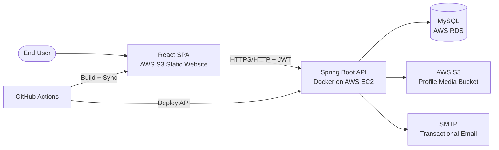

# FinTech Application

<p align="center">
  
  
  
  
  
  
  
  
</p>

<p align="center">
  <strong>Secure • Cloud-Native • Production-Ready Banking Platform</strong><br/>
  A full-stack FinTech system for account management, payments, transfers, auditing, and cloud document storage — engineered with enterprise-grade security and DevOps automation.
</p>

---

## 📑 Table of Contents

- [Overview](#-overview)
- [Key Features](#-key-features)
- [System Architecture](#-system-architecture)
- [Tech Stack](#-tech-stack)
- [Security Model](#-security-model)
- [Repository Layout](#-repository-layout)
- [Getting Started](#-getting-started)
- [Configuration](#-configuration)
- [Deployment & DevOps](#-deployment--devops)
- [API Documentation](#-api-documentation)
- [Frontend Application](#-frontend-application)
- [Contributing](#-contributing)
- [License](#-license)

---

## 📌 Overview

**FinTech Application** is a cloud-native banking platform that delivers secure payment flows, multi-account management, role-based operations, and integrated AWS storage.

The system is split into two deployable units:

| Component | Hosting | Responsibility |
|-----------|---------|----------------|
| **Backend API** (this repository) | AWS EC2 + Docker | Business logic, JWT auth, transactions, audit, email, S3 uploads |
| **React SPA** (`fintech-react`) | AWS S3 Static Website Hosting | Customer / auditor UX, routing, API consumption |

Architecture priorities:

- **Security-first** — JWT authentication, RBAC, CORS allowlists, token blacklist on logout
- **Reliability** — idempotent transactions, ledger-style entries, daily / per-transfer limits
- **Cloud readiness** — Dockerized API, S3 frontend & profile media, RDS-backed MySQL, GitHub Actions CD

---

## ✨ Key Features

### 🔐 Authentication & Identity
- Customer self-registration with automatic savings account provisioning
- JWT-based login (stateless sessions)
- Forgot / reset password via email verification codes
- Logout with server-side token blacklisting

### 💳 Accounts & Payments
- Multi-account overview with balances
- **Deposit**, **withdrawal**, and **transfer** operations
- Idempotency support via `Idempotency-Key` header
- Configurable daily outgoing and max single-transaction limits
- Transaction history with pagination
- Email notifications on debit / credit events

### 👤 Profile & Documents
- Profile management and password change
- Profile picture upload to **AWS S3**
- Secure media retrieval through cloud storage

### 🧾 Audit & Administration
- Role-based dashboards for **ADMIN** and **AUDITOR**
- System totals and supervisory lookups (users, accounts, transactions)
- Role CRUD for administrators
- Seeded default roles and admin bootstrap user

### ☁️ Cloud & Ops
- Backend packaged as a multi-stage Docker image
- Frontend static hosting on S3
- CI validation + CD deploy to EC2 via GitHub Actions

---

## 🏗 System Architecture

### High-level data flow



### ASCII topology

```text
┌──────────────────────────────┐
│  Browser (Customer/Auditor)  │
└──────────────┬───────────────┘
               │
               ▼
┌──────────────────────────────┐
│  React SPA on AWS S3         │
│  (Static Website Hosting)    │
└──────────────┬───────────────┘
               │  REST + Bearer JWT
               ▼
┌──────────────────────────────┐
│  Spring Boot on AWS EC2      │
│  Docker Container :8090      │
│  Spring Security + JWT       │
└──────┬───────────┬───────────┘
       │           │
       ▼           ▼
┌────────────┐  ┌─────────────────┐
│ MySQL RDS  │  │ S3 Media Bucket │
└────────────┘  └─────────────────┘
```

**Request path (example — transfer):**

1. User authenticates via `/api/auth/login` → receives JWT  
2. React stores token and attaches `Authorization: Bearer <token>`  
3. API validates JWT, enforces role / ownership rules  
4. Transaction service applies limits, writes ledger entries, emits email  
5. Client refreshes balances / transaction history  

---

## 🛠 Tech Stack

### Backend (this repo)

| Layer | Technology |
|-------|------------|
| Language | **Java 21** |
| Framework | **Spring Boot 4.1** |
| Security | **Spring Security** + **JWT** (JJWT) |
| Persistence | **Spring Data JPA** / **Hibernate** |
| Database | **MySQL** (local or **AWS RDS**) |
| Mail | Spring Mail + Thymeleaf templates |
| Cloud SDK | AWS S3 (profile pictures) |
| Build | Maven (`mvnw`) |
| Runtime | Docker / Docker Compose |

### Frontend (companion repo: `fintech-react`)

| Layer | Technology |
|-------|------------|
| UI | **React 19** (Create React App) |
| Routing | **React Router** (SPA) |
| HTTP | **Axios** |
| Styling | Custom CSS (`index.css`) |
| Auth UX | Role-aware route guards (`CUSTOMER`, `AUDITOR`, `ADMIN`) |

### Infrastructure

| Service | Usage |
|---------|--------|
| **AWS EC2** | Hosts the Spring Boot container |
| **AWS S3** | Frontend static site + backend object storage |
| **AWS RDS** | Managed MySQL for production |
| **Docker / Compose** | Build & run the API |
| **GitHub Actions** | Validate builds and deploy to EC2 |

---

## 🔒 Security Model

### JWT Authentication

```text
Client                  API                         Token Store
  │                      │                               │
  │  POST /api/auth/login│                               │
  │─────────────────────►│  validate credentials         │
  │                      │  issue JWT (email + claims)   │
  │◄─────────────────────│                               │
  │  Authorization: Bearer <jwt>                         │
  │─────────────────────►│  AuthFilter verifies signature│
  │                      │  check blacklist ────────────►│
  │                      │  load authorities (roles)     │
```

- **Algorithm:** HMAC-SHA256  
- **Subject:** user email  
- **Extra claim:** token version (`tv`) for invalidation strategy  
- **Logout:** token added to an in-memory blacklist  
- **Session policy:** fully **stateless** (`SessionCreationPolicy.STATELESS`)

### Role-Based Access Control (RBAC)

| Role | Capabilities |
|------|----------------|
| **CUSTOMER** | Own profile, accounts, transfers, transaction history |
| **AUDITOR** | Read-only supervisory queries + deposit operations (UI) |
| **ADMIN** | Full audit access, user listing, role management |

Enforced via:

- `SecurityFilter` — `/api/auth/**` is public; all other routes require authentication  
- Method-level `@PreAuthorize` / authority checks on controllers  

### CORS Protection

Cross-origin access is **explicitly allowlisted** (no wildcard origins with credentials):

```properties
# application.properties (env-overridable)
app.cors.allowed-origins=${CORS_ALLOWED_ORIGINS:http://localhost:3000,http://localhost:5173,http://fintech-react-s3-bucket-v1.s3-website.eu-north-1.amazonaws.com}
```

Configured in `CorsConfig`:

- Allowed origins from `CORS_ALLOWED_ORIGINS`
- `allowCredentials = true`
- All methods / headers for registered SPA origins only

> **Production tip:** Keep the S3 website origin in `CORS_ALLOWED_ORIGINS` on EC2, and open the API port (default **8090**) in the EC2 Security Group.

---

## 📁 Repository Layout

```text
fintech/
├── .github/workflows/          # CI validate + CD deploy
│   ├── validate.yml
│   └── deploy.yml
├── src/main/java/com/fintech/fintech/
│   ├── auth/                   # Register, login, password reset, users
│   ├── account/                # Accounts lifecycle
│   ├── transaction/            # Deposit / withdraw / transfer + ledger
│   ├── audit/                  # Auditor / admin read APIs
│   ├── role/                   # Role administration
│   ├── security/               # JWT, filters, CORS
│   ├── aws/                    # S3 integration
│   ├── exception/              # Global exception + validation mapping
│   └── ...
├── src/main/resources/
│   ├── application.properties
│   ├── messages*.properties    # i18n (en / ar)
│   └── templates/              # Email templates
├── DockerFile                  # Multi-stage JDK 21 → JRE 21 image
├── compose.yml                 # App service on port 8090
├── pom.xml
└── .env                        # Local/prod secrets (gitignored)
```

---

## 🚀 Getting Started

### Prerequisites

| Tool | Version / Notes |
|------|-----------------|
| JDK | **21+** |
| Maven | Wrapper included (`mvnw` / `mvnw.cmd`) |
| MySQL | **8.x** running locally or reachable RDS instance |
| Docker | Optional, for containerized runs |
| Node.js | **18+** (frontend companion repo only) |

### 1. Clone & configure Backend

```bash
git clone https://github.com/<your-org>/fintech.git
cd fintech
```

Create a `.env` file in the project root (do **not** commit secrets):

```env
# Database
PROD_DB_URL=jdbc:mysql://localhost:3306/fintech_db
PROD_DB_USERNAME=root
PROD_DB_PASSWORD=your_password

PORT=8090

# JWT
JWT_SECRET=replace_with_a_long_random_secret
JWT_EXPIRATION_TIME=2592000000

# Mail
MAIL_USER=your_smtp_user
MAIL_PASS=your_smtp_app_password

# AWS (profile pictures + optional ops)
AWS_ACCESS_KEY=your_access_key
AWS_SECRET_KEY=your_secret_key
AWS_BUCKET_NAME=your-media-bucket

# CORS — include local SPA + production S3 website
CORS_ALLOWED_ORIGINS=http://localhost:3000,http://fintech-react-s3-bucket-v1.s3-website.eu-north-1.amazonaws.com
```

Ensure the MySQL database schema/database exists (Hibernate `ddl-auto` defaults to `update`).

### 2. Run Backend with Maven

```bash
# Windows
.\mvnw.cmd spring-boot:run

# Linux / macOS
./mvnw spring-boot:run
```

API base URL (local):

```text
http://localhost:8090/api
```

### 3. Run Backend with Docker Compose

```bash
docker compose -f compose.yml up --build -d
```

- Container maps **`8090:8090`**
- Environment variables are injected from `.env`
- Health-check manually: `curl http://localhost:8090/api/auth/login` (expects validation / method response, not connection refused)

> **Note:** Compose runs the API only. MySQL must already be reachable via `PROD_DB_URL`.

### 4. Run Frontend (companion repository)

```bash
git clone https://github.com/<your-org>/fintech-react.git
cd fintech-react
npm install
```

Point the Axios base URL in `src/services/api.js` to your API:

```js
const API_BASE_URL = "http://localhost:8090/api";
```

```bash
npm start
```

SPA runs at `http://localhost:3000`.

---

## ⚙ Configuration

| Property / Env | Purpose | Default / Example |
|----------------|---------|-------------------|
| `PORT` | HTTP port | `8090` |
| `PROD_DB_URL` | JDBC URL | MySQL local or RDS |
| `JWT_SECRET` | HMAC signing key | required |
| `JWT_EXPIRATION_TIME` | Token TTL (ms) | `2592000000` (~30 days) |
| `CORS_ALLOWED_ORIGINS` | Allowed SPA origins | localhost + S3 site |
| `AWS_BUCKET_NAME` | Profile media bucket | required for uploads |
| `PASSWORD_RESET_LINK` | Frontend reset URL prefix | S3 `/reset-password?code=` |
| `DAILY_OUTGOING_LIMIT` | Daily send cap | `50000.00` |
| `MAX_SINGLE_AMOUNT` | Per-txn cap | `10000.00` |

Spring loads optional `.env` via:

```properties
spring.config.import=optional:file:.env[.properties]
```

---

## 🚢 Deployment & DevOps

### CI/CD with GitHub Actions

#### 1) Validate pipeline — `.github/workflows/validate.yml`

- **Trigger:** push to any branch  
- **Steps:** checkout → setup Temurin JDK 21 → `mvn clean package -DskipTests`  
- **Goal:** fail fast on broken builds before merge/deploy  

#### 2) Deploy pipeline — `.github/workflows/deploy.yml`

- **Trigger:** push to `master`  
- **Steps:** SSH into EC2 (`appleboy/ssh-action`) → `git pull` → `docker-compose up --build -d`  
- **Required secrets:** `SSH_HOST`, `SSH_PRIVATE_KEY`

```text
┌─────────────┐     push/master      ┌──────────────────┐
│   GitHub    │ ───────────────────► │  GitHub Actions  │
└─────────────┘                      └────────┬─────────┘
                                              │ SSH
                                              ▼
                                     ┌──────────────────┐
                                     │  AWS EC2         │
                                     │  docker compose  │
                                     │  rebuild & run   │
                                     └──────────────────┘
```

### Backend on AWS EC2 (Docker)

1. Provision EC2 (Amazon Linux recommended) with Docker + Compose  
2. Clone this repository under e.g. `/home/ec2-user/projects/fintech`  
3. Place production `.env` on the instance (never commit it)  
4. Open **Security Group** inbound TCP **8090** (or 80 if you terminate TLS / reverse-proxy in front)  
5. Deploy:

```bash
cd /home/ec2-user/projects/fintech
git pull
docker compose -f compose.yml up --build -d
```

### Frontend on AWS S3 (Static Website)

```bash
cd fintech-react
# Ensure API_BASE_URL points to the EC2 public IP/DNS + /api
npm run build

aws s3 sync build/ s3://fintech-react-s3-bucket-v1 --delete
# If using CloudFront, invalidate the distribution cache
```

Enable **Static website hosting** on the bucket and add the website origin to backend `CORS_ALLOWED_ORIGINS`.

---

## 📡 API Documentation

Base path: `/api`  
Auth header (protected routes): `Authorization: Bearer <token>`

### Authentication

| Method | Endpoint | Auth | Description |
|--------|----------|------|-------------|
| `POST` | `/api/auth/register` | Public | Register customer + create savings account |
| `POST` | `/api/auth/login` | Public | Authenticate and receive JWT |
| `POST` | `/api/auth/forgot-password` | Public | Send password-reset email |
| `POST` | `/api/auth/reset-password` | Public | Reset password with verification code |

### Users & Profile

| Method | Endpoint | Auth | Description |
|--------|----------|------|-------------|
| `GET` | `/api/users/me` | JWT | Current user profile |
| `PUT` | `/api/users/me/password` | JWT | Change password |
| `PUT` | `/api/users/me/profile-picture` | JWT | Upload profile image to S3 |
| `POST` | `/api/users/me/logout` | JWT | Blacklist current token |
| `GET` | `/api/users` | ADMIN | Paginated user list |

### Accounts

| Method | Endpoint | Auth | Description |
|--------|----------|------|-------------|
| `GET` | `/api/accounts/me` | JWT | List current user’s accounts |
| `DELETE` | `/api/accounts/{accountNumber}` | JWT | Close account (zero balance required) |

### Transactions

| Method | Endpoint | Auth | Description |
|--------|----------|------|-------------|
| `POST` | `/api/transactions` | JWT | Create deposit / withdrawal / transfer (`Idempotency-Key` supported) |
| `GET` | `/api/accounts/{accountNumber}/transactions` | JWT | Paginated account history |

### Audit (ADMIN / AUDITOR)

| Method | Endpoint | Auth | Description |
|--------|----------|------|-------------|
| `GET` | `/api/audit/totals` | ADMIN / AUDITOR | System-wide totals |
| `GET` | `/api/audit/users?email=` | ADMIN / AUDITOR | Lookup user by email |
| `GET` | `/api/audit/accounts/{accountNumber}` | ADMIN / AUDITOR | Account details |
| `GET` | `/api/audit/accounts/{accountNumber}/transactions` | ADMIN / AUDITOR | Supervisory transaction list |
| `GET` | `/api/audit/transactions/{id}` | ADMIN / AUDITOR | Transaction by ID |

### Roles (ADMIN)

| Method | Endpoint | Auth | Description |
|--------|----------|------|-------------|
| `GET` | `/api/roles` | ADMIN | List roles |
| `POST` | `/api/roles` | ADMIN | Create role |
| `PUT` | `/api/roles` | ADMIN | Update role |
| `DELETE` | `/api/roles/{id}` | ADMIN | Delete role |

### Standard response shape

```json
{
  "success": false,
  "statusCode": 400,
  "message": "Validation failed",
  "data": {
    "phoneNumber": "Invalid Egyptian phone number format"
  },
  "timestamp": "2026-07-31T12:22:38.320709996Z"
}
```

---

## 🖥 Frontend Application

Companion SPA features:

| Area | Routes / Notes |
|------|----------------|
| Public | `/`, `/login`, `/register`, `/forgot-password`, `/reset-password` |
| Customer | `/profile`, `/transfer`, `/transactions`, `/update-profile` |
| Auditor / Admin | `/auditor-dashboard`, `/deposit` |
| Guards | `PrivateRoute`, `CustomerRoute`, `AuditorRoute` |

Brand UI: **FinTech Bank** navbar with role-aware navigation.

---

## 🤝 Contributing

Contributions that improve security, reliability, or developer experience are welcome.

1. Fork the repository  
2. Create a feature branch: `git checkout -b feature/your-change`  
3. Commit with a clear message  
4. Ensure `./mvnw clean package` succeeds  
5. Open a Pull Request against `master`  

### Guidelines

- Never commit `.env`, credentials, or private keys  
- Prefer small, reviewable PRs  
- Match existing package structure and error-handling patterns  
- Add / update tests when changing domain logic  

---

## 📄 License

This project is released under the **MIT License**.

```text
MIT License

Copyright (c) 2026 FinTech Application Contributors

Permission is hereby granted, free of charge, to any person obtaining a copy
of this software and associated documentation files (the "Software"), to deal
in the Software without restriction, including without limitation the rights
to use, copy, modify, merge, publish, distribute, sublicense, and/or sell
copies of the Software, and to permit persons to whom the Software is
furnished to do so, subject to the following conditions:

The above copyright notice and this permission notice shall be included in all
copies or substantial portions of the Software.

THE SOFTWARE IS PROVIDED "AS IS", WITHOUT WARRANTY OF ANY KIND, EXPRESS OR
IMPLIED, INCLUDING BUT NOT LIMITED TO THE WARRANTIES OF MERCHANTABILITY,
FITNESS FOR A PARTICULAR PURPOSE AND NONINFRINGEMENT.
```

> If you prefer a different license for public GitHub release, replace this section and add a root `LICENSE` file accordingly.

---

## 🙌 Acknowledgements

Built with Spring Boot, React, Docker, and AWS — designed for real-world FinTech delivery: secure APIs, cloud hosting, and automated pipelines.

<p align="center">
  <sub>Crafted for production. Documented for engineers.</sub>
</p>
